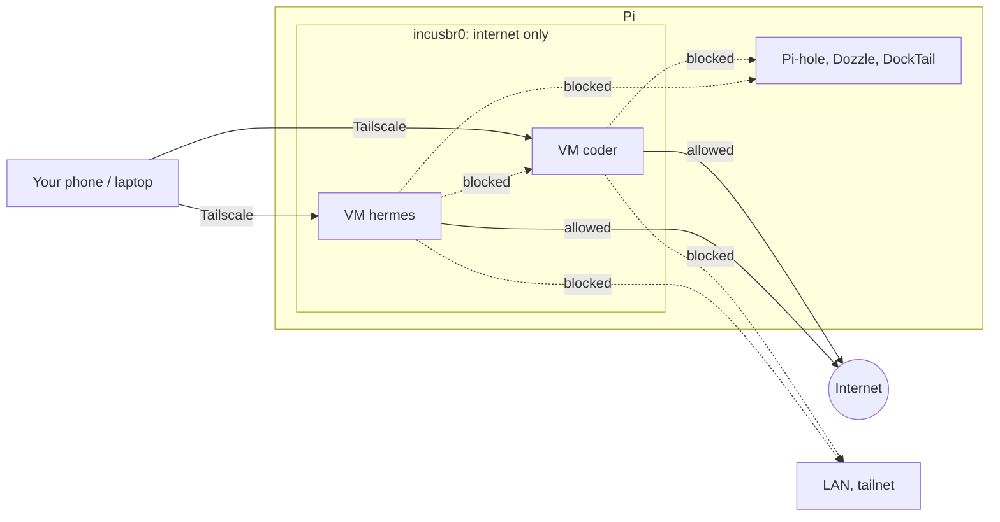

# Agent VMs

Two [Incus](https://linuxcontainers.org/incus/) virtual machines run AI
agents on the Pi:

| VM | Runs | Holds | Size |
|---|---|---|---|
| `coder` | Claude Code, Codex, Docker, `gh` | Claude and ChatGPT logins, a GitHub token | 3 vCPU, 6 GiB, 60 GiB disk |
| `hermes` | [Hermes Agent](https://github.com/NousResearch/hermes-agent) gateway + dashboard | Hermes's ChatGPT login and memory | 2 vCPU, 3 GiB, 30 GiB disk |

Inside its VM an agent is root: it can install anything, run Docker and use
the web. Nothing else of yours is in there, and it cannot get out.

## What keeps the agents in



Each control sits outside the VMs, where an agent cannot change it:

| Control | Where | Stops |
|---|---|---|
| A VM per agent | `vms/create.sh` | Access to the Pi's kernel, files, Docker and containers |
| `agent-egress` ACL | [agent-egress.yaml](../infra/incus/agent-egress.yaml) | Reaching anything private: LAN, Docker apps, the Pi, the tailnet through the Pi. Allows public IPv4 only; IPv6 is off |
| Port isolation + IPv4/MAC filtering | [agent-vm.yaml](../infra/incus/agent-vm.yaml) | The VMs reaching or impersonating each other |
| Tailscale policy | [prerequisites](prerequisites.md#1-tailscale-admin-console) | `tag:agent` reaching anything on the tailnet; only your devices reach the VMs |

`hermes` is separate from `coder` because Hermes reads untrusted web pages
and messages; a hijacked Hermes must not reach the GitHub token.

What this does not stop: an agent sending what it can read in its own VM
(logins, code) anywhere on the internet. Keep tokens narrow (below).

## Create a VM

Needs `sudo ./setup.sh bootstrap` once (installs Incus, the bridge, the ACL
and the profile) and the `tag:agent` policy from
[prerequisites](prerequisites.md#1-tailscale-admin-console).

```sh
sudo ./vms/create.sh coder
sudo ./vms/create.sh hermes
```

Each run takes several minutes and prints a Tailscale login link halfway
through: open it as a tailnet admin to add the VM as `tag:agent`. The script
creates a VM only once; it refuses to touch an existing one.

Then [check the boundary](#check-the-boundary) and sign in.

## Sign in (once per VM)

Logins live only inside their VM. Never copy them between VMs: Codex
replaces its refresh token on use, so a copy breaks the other one.

**coder** (`ssh agent@coder`):

1. Claude Code: `claude`, then `/login`.
2. Codex: enable device-code login in ChatGPT's security settings, then
   `codex login --device-auth`.
3. GitHub: create a fine-grained token for only the repositories the agent
   works on (Contents and Pull requests: read/write; Metadata: read; with an
   expiry), then `gh auth login --with-token` and `gh auth setup-git`.
   Protect `main` on those repositories with a ruleset that requires a pull
   request. Never give an agent write access to this repository.

**hermes** (`ssh agent@hermes`):

1. `hermes auth add openai-codex`, then approve the device code.
2. Dashboard password (user `hermes`): `sudo cat /etc/hermes/dashboard.env`.

## Everyday use

**Code from your laptop:**

```sh
ssh agent@coder
tmux new -A -s main          # survives disconnects
cd ~/work && claude          # or codex
```

Work leaves the VM as a branch and a pull request; review it on GitHub. A
dev server the agent starts is at `http://coder:<port>`. Use one git
worktree per task under `~/work`; one heavy task at a time fits the Pi.

**Claude Code from your phone:** run `claude remote-control` in tmux on
`coder` and continue in the Claude app.

**Hermes from your phone:** with Tailscale on, open
`https://hermes.<tailnet>.ts.net` and sign in; add it to the home screen.
Risky commands wait there for your approval.

**Change Hermes settings:** on the dashboard's Config page. They persist;
[vms/hermes/config.yaml](../vms/hermes/config.yaml) is only the starting
point for a new VM.

**A tool cannot connect:** anything public over IPv4 works. LAN and tailnet
addresses are blocked on purpose, as is anything IPv6-only. For git, prefer
HTTPS with the fine-grained token (`gh auth setup-git`) over SSH keys.

**Shell from the Pi:** `sudo incus exec coder -- su - agent`.

## Updates

| What | How |
|---|---|
| Debian packages in the VMs | Automatic (unattended-upgrades) |
| Tailscale in the VMs | Automatic (`--auto-update`) |
| Claude Code | Updates itself |
| Codex | `ssh agent@coder sudo npm install -g @openai/codex@latest` |
| Hermes | `ssh agent@hermes 'hermes update && sudo systemctl restart hermes-gateway hermes-dashboard'` |
| Incus and QEMU on the Pi | `sudo apt update && sudo apt upgrade` (on bookworm add `-t bookworm-backports`: backports are not auto-updated), then `sudo incus restart coder hermes` |

Incus and QEMU are the boundary itself; keep them current. Restarting a VM
interrupts its agents.

## Resize a VM

```sh
sudo incus stop coder
sudo incus config set coder limits.cpu=4 limits.memory=8GiB
sudo incus config device set coder root size=80GiB   # disks only grow
sudo incus start coder
```

## Snapshots, backups, rebuilds

```sh
sudo incus snapshot create coder before-x     # before something risky
sudo incus snapshot restore coder before-x    # roll back
sudo incus snapshot delete coder before-x     # a snapshot is a full disk copy here
```

Restoring `coder` brings back an old Codex token; run `codex login` again if
it fails.

To rebuild from scratch:

```sh
sudo incus delete --force coder
sudo ./vms/create.sh coder
```

Then remove the old device in the Tailscale admin console and sign in
again. What a rebuild loses: unpushed work in `~/work` on `coder`; Hermes's
memory, sessions, skills and settings in `~/.hermes` on `hermes`. Back that
up first:

```sh
sudo incus exec hermes -- tar -C /home/agent -czf - .hermes > hermes-home.tgz
```

## If a login leaks

An agent can read every login in its VM. Limit the damage:

1. Claude: claude.ai → Settings → sign out of all sessions.
2. ChatGPT: chatgpt.com → Settings → Security → log out of all devices.
3. GitHub: revoke the fine-grained token.
4. Tailscale: remove the VM's device in the admin console.
5. Rebuild the VM (above).

## Check the boundary

Run after creating the VMs and after changing anything in `infra/incus/`.

```sh
GW=$(ip -4 route | awk '/default/ {print $3; exit}')
PI_TS=$(tailscale ip -4)
DOZZLE=$(docker inspect -f '{{range .NetworkSettings.Networks}}{{.IPAddress}}{{end}}' "$(docker ps -qf name=dozzle)")
CODER=$(sudo incus exec coder -- ip -4 -o addr show scope global | awk '{print $4}' | cut -d/ -f1 | grep '^10\.250\.0\.')
reach() {
    if sudo incus exec coder -- timeout 5 bash -c "</dev/tcp/$2/$3" 2>/dev/null
    then echo "$1: open"; else echo "$1: blocked"; fi
}

reach internet github.com 443        # open
reach router "$GW" 80                # blocked
reach dozzle "$DOZZLE" 8080          # blocked
reach pihole-dns "$PI_TS" 53         # blocked
sudo incus exec hermes -- ping -c1 -W2 "$CODER"   # 100% packet loss
```

"blocked" only means something if the target is up: from the Pi itself,
`curl -sI "http://$GW"` should answer (pick another LAN device if your router
does not serve HTTP).

## Troubleshooting

- **No internet in a VM:** `sudo incus exec coder -- curl -sI https://github.com`.
  Check that `sudo ufw status` shows `ALLOW FWD` for `incusbr0` and that
  `sudo incus network get incusbr0 security.acls` prints `agent-egress`.
  Known suspect: Docker loads `br_netfilter` (`lsmod | grep br_netfilter`),
  which also sends bridged VM traffic through the host firewall.
- **VM missing from the tailnet:** `sudo incus exec <vm> -- tailscale status`.
  If logged out, `sudo incus exec <vm> -- tailscale up --advertise-tags=tag:agent --ssh --accept-dns=false`
  prints a new login link.
- **Hermes dashboard down:**
  `sudo incus exec hermes -- journalctl -u hermes-dashboard -u hermes-gateway -n 100`.
- **`create.sh` failed halfway:** `sudo incus delete --force <vm>` and run it
  again; remove any half-added device in the Tailscale admin console.
