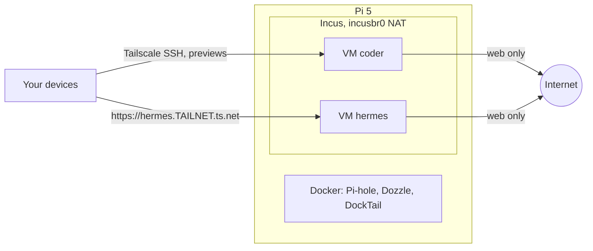

# Agent VMs

Two [Incus](https://linuxcontainers.org/incus/) virtual machines run AI
agents next to the Docker apps:

| VM | Runs | Holds | Size (`vms/<vm>/vm.conf`) |
|---|---|---|---|
| `coder` | Claude Code, Codex, Docker, `gh` | Claude and ChatGPT logins, a GitHub token | 3 vCPU, 6 GiB, 60 GiB disk |
| `hermes` | [Hermes Agent](https://github.com/NousResearch/hermes-agent) gateway + dashboard | Hermes's own ChatGPT login, its memory | 2 vCPU, 3 GiB, 30 GiB disk |

Inside its VM an agent has root, apt, Docker and the web. Isolation comes
from outside the VM, where the agent cannot change it:

| Layer | Enforces |
|---|---|
| The VM | A separate kernel from the Pi, its containers and its files |
| `agent-egress` ACL ([infra/incus](../infra/incus/agent-egress.yaml)) | Out: TCP 80/443, UDP 443/123, Tailscale UDP, ICMP. Blocked: LAN, tailnet, this host, the other VM. In: DHCP replies only |
| Tailscale policy ([prerequisites](prerequisites.md#1-tailscale-admin-console)) | Only your devices reach `tag:agent`; `tag:agent` reaches nothing on the tailnet |
| Incus limits | CPU, memory and disk per VM; Pi-hole has a low OOM score |

Hermes and the coding agents are in separate VMs because Hermes reads
untrusted web content and should not sit next to the GitHub token and
Claude login.



## Access

Each VM is its own tailnet device (`coder`, `hermes`) with Tailscale SSH. No
SSH server runs in the VMs.

```sh
ssh agent@coder                  # then: tmux new -A -s main
open http://coder:3000           # a dev server the agent started
open https://hermes.<tailnet>.ts.net
```

From the Pi itself: `sudo incus exec coder -- su - agent`.

## Sign-ins (once per VM)

Logins live only inside the VM. Reconcile never touches them, and they are
never copied between VMs: Codex replaces its refresh token on use, so a copy
breaks the other one.

**coder**, over `ssh agent@coder`:

1. Claude Code: run `claude`, then `/login` with your Claude subscription.
   For phone access, start `claude remote-control` inside tmux and continue
   the session in the Claude app.
2. Codex: enable device-code login in ChatGPT's security settings, then
   `codex login --device-auth`.
3. GitHub: create a fine-grained token limited to the repositories the
   agent works on (Contents and Pull requests: read/write; Metadata: read;
   with an expiry). Then `gh auth login --with-token` and
   `gh auth setup-git`. Protect `main` on those repositories with a ruleset
   that requires a pull request. Never give an agent write access to this
   repository.

**hermes**, over `ssh agent@hermes`:

1. `hermes auth add openai-codex`, then approve the device code with your
   ChatGPT account.
2. Dashboard password: `sudo cat /etc/hermes/dashboard.env` (user
   `hermes`).

## Working

- Long tasks run in tmux on `coder` and survive disconnects. One heavy task
  at a time fits the Pi; use one git worktree per task under `~/work`.
- Work leaves the VM as a branch and a draft PR. Review it on GitHub.
- Hermes approvals are `smart`: risky commands wait for you on the
  dashboard; everything else runs.

## Changes and updates

`sudo ./setup.sh reconcile coder` or `reconcile hermes` (never part of a
plain `reconcile`):

- creates the VM if missing and applies `vm.conf` (memory/CPU changes may
  need `sudo incus restart <vm>`; disks only grow);
- re-runs [vms/base.sh](../vms/base.sh) and the VM's `provision.sh`;
- joins the tailnet the first time, asking for a `tag:agent` auth key.

| Component | Updated by |
|---|---|
| Debian packages in the VMs | unattended-upgrades (daily) |
| Tailscale in the VMs | Tailscale auto-update |
| Codex | every `reconcile coder` (latest release) |
| Claude Code | its own auto-updater |
| Hermes | the pinned commit in [vms/hermes/provision.sh](../vms/hermes/provision.sh); change it and reconcile |
| Hermes settings | [vms/hermes/config.yaml](../vms/hermes/config.yaml); reconcile replaces the live copy and restarts Hermes when they differ |

Reconcile restarts Hermes only when its code, config or units changed. It
never restarts `coder`.

## Backups

The repo rebuilds both VMs. What it cannot rebuild:

- `hermes`: `~/.hermes` (memory, sessions, skills, login).
- `coder`: unpushed work in `~/work`. Logins can be redone.

Before a risky change: `sudo incus snapshot create <vm> before-x`; roll back
with `sudo incus snapshot restore <vm> before-x`. On this storage pool a
snapshot is a full copy of the disk, so delete it afterwards
(`sudo incus snapshot delete <vm> before-x`). Restoring `coder` brings back
an old Codex token; run `codex login` again if it fails.

## If a login leaks

The agent can read every login in its VM. Limit the damage, then:

1. Claude: claude.ai → Settings → sign out of all sessions.
2. ChatGPT: chatgpt.com → Settings → Security → log out of all devices.
3. GitHub: revoke the fine-grained token.
4. Tailscale: remove the VM's device in the admin console.
5. Rebuild: `sudo incus delete --force <vm>`, then `reconcile <vm>`.

## Troubleshooting

- **No internet in a VM:** `sudo incus exec coder -- curl -sI https://github.com`.
  Check `sudo ufw status` shows `ALLOW FWD` for `incusbr0` and
  `sudo incus network acl show agent-egress`.
- **A tool needs another port** (SSH to GitHub, SMTP, a database): blocked
  by design. Use HTTPS, or add a narrow rule to
  [agent-egress.yaml](../infra/incus/agent-egress.yaml) and run
  `sudo ./setup.sh bootstrap`.
- **VM not on the tailnet:** `sudo incus exec <vm> -- tailscale status`. If
  it is logged out, reconcile asks for a new auth key.
- **Hermes dashboard:** `sudo incus exec hermes -- journalctl -u hermes-dashboard -u hermes-gateway -n 100`.
